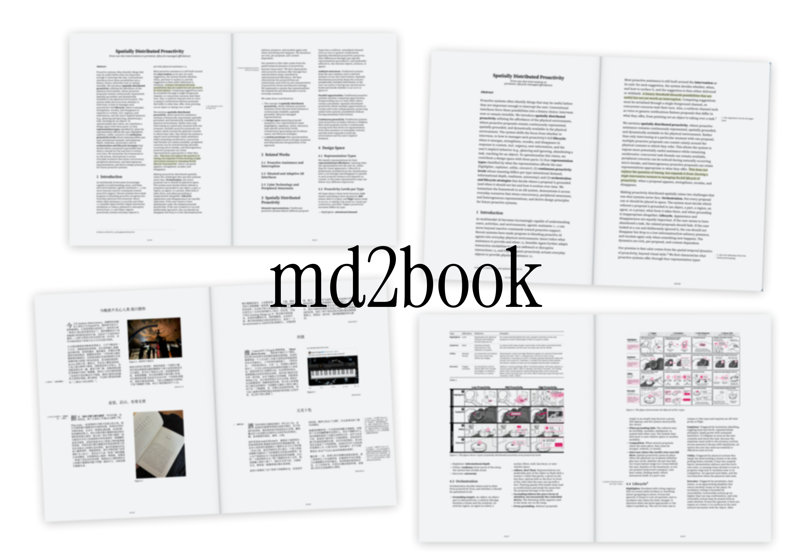

# Format Guide: Everything You Can Write

This note is its own example. Open it in md2book: each item gives the syntax in grey code, and right after it, the thing itself as the reader prints it. This first paragraph opens with a large drop cap, which every note gets when it starts with an ordinary paragraph (it can be turned off in settings).

## Front matter

The block between `---` lines at the very top of a note. Every field is optional; this note's own front matter has `created`, `updated` and `publishID`, and its byline sits under the title.

| Field | What it does |
|---|---|
| `created: 2026-04-02` | The date in the byline; also orders notes in a collection, oldest first. |
| `updated: 2026-04-05` | The "updated" date in the byline. |
| `publish: false` | Keeps the note unpublished. |
| `publishID: kyoto-spring` | A fixed address: renaming or moving the file doesn't break links. |
| `publishTag: [japan, trips]` | Adds the note to these collections (it's also in its top-level folder's). |

Without `created`/`updated`, a local note uses its file's own dates.

## Titles and headings

- `# Title` — the first level-1 heading is the note's title, not part of the text. Without one, the file name is used.
- `# Title: Subtitle` — the title splits at the first `/ ／ : ： | ｜` (changeable in settings), as this note's does.
- `## Heading`, `### Subheading` — numbered automatically, like the ones here (1, 1.1…). A first heading named "Abstract" isn't numbered.
- English headings are set in Title Case.
- A "private heading" (a level-2 heading whose text you choose in settings) hides itself and everything after it: a scratchpad at the end of a note.

## Inline styles

- `**bold**` → **bold**
- `*italic*` → *italic*
- `~~struck~~` → ~~struck~~
- `` `code` `` → `code`
- `==highlight==` → ==highlight==
- `up`, `down`, `<u>under</u>` (any HTML) → xup, xdown, <u>under</u>
- Straight quotes and dashes become typographic: `"quoted" -- 'single'` → "quoted" -- 'single'

## Quotes and callouts

A line starting with `> ` is a quote:

> Imagination is more important than knowledge.

It's set in from both sides in smaller type (Chinese in Fangsong). The reader's Space menu can hide every quote in a note (Hide quotes), remembered on that device.

A quote whose first line is `> [!note] Title` is an Obsidian callout:

> [!note] A callout
> Its title runs in at the start of the text. A fold mark (`[!note]-` or `[!note]+`) is ignored: it's always open. Hide quotes leaves callouts in place.

## Margin notes

There are no notes at the foot of the page: footnotes and comments go in the margin, beside the line they belong to, numbered together.

- A footnote: `text[^1]`, and on a line of its own, `[^1]: The note.` → text[^1]
- An inline footnote: `text^[The note.]` → text^[An inline footnote, written right where it goes.]
- A comment on a passage: `{==passage==}{>>The comment.<<}` → a {==marked passage==}{>>A CriticMarkup comment: the passage prints as usual, and this goes in the margin.<<} in a sentence.
- A heading can carry a comment too.

[^1]: A footnote. Its text can continue on indented lines under it.

## Edits (CriticMarkup)

Only the final copy prints:

| Syntax | Prints |
|---|---|
| `{++added++}` | {++added++} |
| `{--deleted--}` | {--deleted--}(nothing) |
| `{~~old~>new~~}` | {~~old~>new~~} |
| `{==highlighted==}` | {==highlighted==} |

A comment `{>>…<<}` on its own, with no passage before it, doesn't print.

## Links and citations

### Links to the web

`[the Kyoto city site](https://www.city.kyoto.lg.jp/)` → [the Kyoto city site](https://www.city.kyoto.lg.jp/), numbered and listed under References at the end. The same address again shares the number: [same site](https://www.city.kyoto.lg.jp/).

### Citations without a label

`text ({==REF==}{>>https://…<<})` prints only the number: as shown here ({==REF==}{>>https://en.wikipedia.org/wiki/Kyoto<<}).

Several, joined by commas, merge into one: `text ({==REF==}{>>…<<}, {==REF==}{>>…<<})` → two sources ({==REF==}{>>https://en.wikipedia.org/wiki/Philosopher%27s_Walk<<}, {==REF==}{>>https://en.wikipedia.org/wiki/Daigo-ji<<}).

The parentheses are only there to keep the Markdown readable in Obsidian: a `(` touching the first citation and a `)` touching the last are dropped. Without them it prints the same: `text{==REF==}{>>…<<}` → like this{==REF==}{>>https://en.wikipedia.org/wiki/Ginkaku-ji<<}.

### Links to other notes

- `[[Another note]]`, `[[Another note|shown text]]`, `[shown text](another-note.md)`, `[[Another note#A heading]]` link to another note. The link reads like a book's title: in bold 「corner brackets」 and Fangsong in Chinese, in italics otherwise, with a small circled L after it, and the page it starts on when it's in the same collection.
- A link to a note that doesn't exist or isn't published prints as plain text: [[A note that does not exist]].
- `[[#Images]]` links to a section of this note and adds its number: see [[#Images]].

### Embedding a note

`![[Another note]]` or `![[Another note#A heading]]`, alone on its line, sets that note (or section) into the text whole, with its source right-aligned after it. Inside a sentence it's just a link.

## Images

- `![[image.png]]` — found by file name anywhere in the vault, as in Obsidian. `![[image.png|300]]` (or `|300x200`) gives a size; `![[image.png|text]]`, alt text.
- `` — a path relative to the note.
- `` — an image on the web, like this one:

//An image with a caption, 60% of the text width. The lines under it: `//An image with a caption…` and `//60`.
//60

Lines starting with `//` right under an image, in any order:

| Line | What it does |
|---|---|
| `//Some caption` or `//(Some caption)` | A caption, numbered (Figure 1, 2…). |
| `//40` | The width, as a percentage of the full text width. In two columns a column is about half of it: `//40` fills 80% of a column, 50 or more fills it. |
| `//teaser` | A header image, under the title and across the text. Only the first one counts. |
| `//span` | Across both columns, at the top of the page it lands on. |
| `//teaser (Caption)`, `//span (Caption)` | A mark and a caption on one line. |

## Tables

Every table is numbered. The same `//` lines go right under it (all but `//teaser`); this one has `//The cherry blossom season in Kyoto.`:

| Place | In bloom |
|---|---|
| Philosopher's Path | early April |
| Daigo-ji | late March |
//The cherry blossom season in Kyoto.

## Lists

- `- item` and `1. item` — ordinary lists, like this one.
- `- [ ] to do` and `- [x] done` — a printed box, ticked in pencil when done:

- [ ] to do
- [x] done

A term, then `: its definition` on the next line, is a definition list, set in two columns:

Gutter
: The inner margin where the pages meet.

## Math

- `$E = mc^2$` → $E = mc^2$
- `$$…$$`, on its own lines or inside a paragraph, is a display formula:

$$
\int_0^1 x^2\,dx = \frac{1}{3}
$$

## Code

`` `inline code` `` and fenced blocks (three backticks) print exactly as written: none of the marks in this guide work inside them.

## What doesn't print

- `#tag` → #example: without the "#", in grey small capitals.
- `%%a comment%%` → nothing: between these%%hidden%% two words.
- `^abc123` (a block id) → nothing.
- `{--deleted--}`, and a `{>>comment<<}` with nothing before it.
- Everything from the private heading on.
- Excalidraw drawings (`*.excalidraw.md`) and canvas files are skipped whole.

## Reading switches

Not syntax, but per note: press Space while reading for the menu.

- **Turn effects off**: no paper effects (show-through, letterpress, ink bleed, the shade in the gutter), plain white paper, and the pages scroll up and down, two to a row.
- **Hide quotes**: every `>` quote in this note hidden (callouts stay).

Both are remembered for each note on that device, across reloads.
